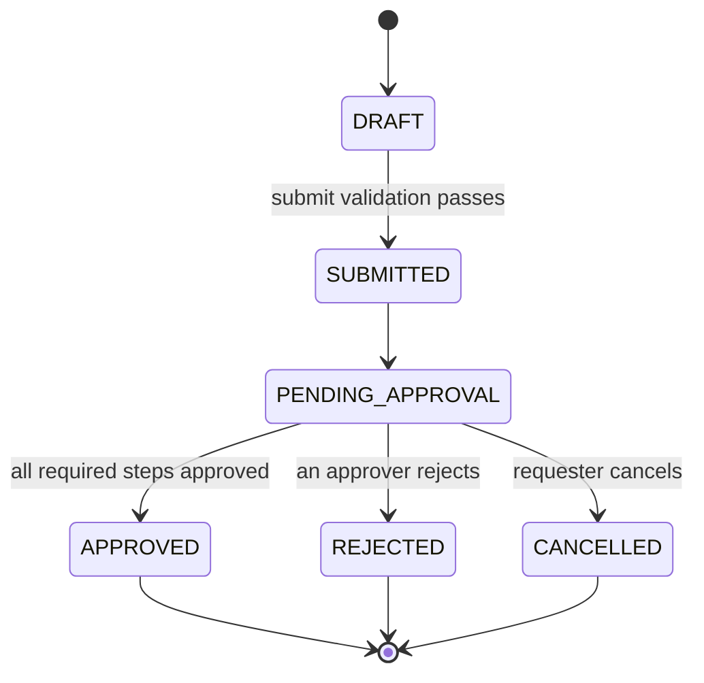
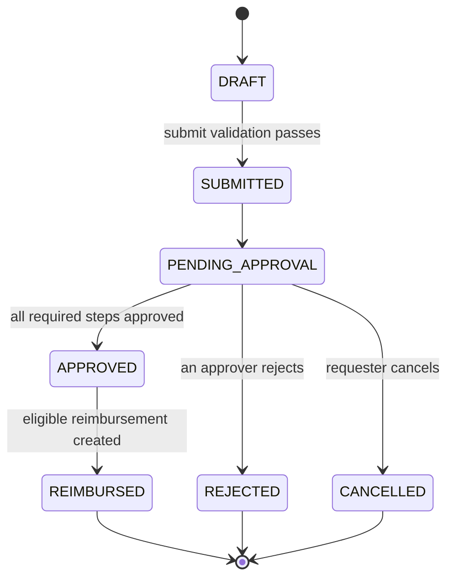
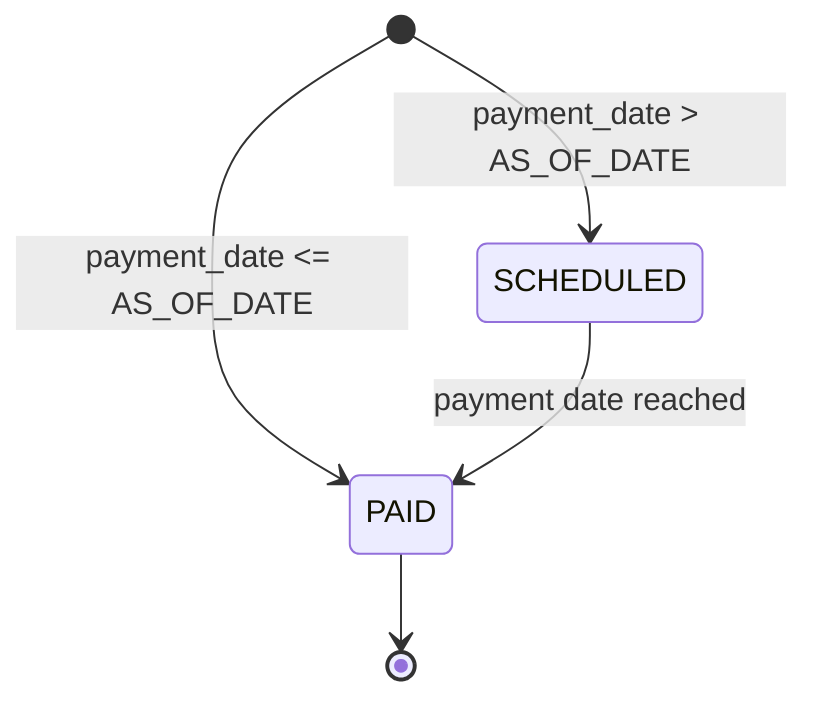

# RouteIQ Entity Relationships and Lifecycles

The public schema contains operational data. `GROUND_TRUTH_ANOMALY` and `GROUND_TRUTH_DECISION` are in the separate PostgreSQL `ground_truth` schema and are readable only by the evaluation service. Arrows below show declared foreign keys; ground-truth references are evaluation-only. The database must not expose ground-truth rows to routing, audit detection, or feature generation.

## Entity relationship diagram

```mermaid
erDiagram
    EMPLOYEE {
        varchar employee_id PK
        char country
        char home_currency
        date hire_date
        date termination_date
        varchar manager_id FK
        enum functional_role
        enum system_role
        smallint job_level
    }
    LEAVE_POLICY {
        varchar leave_policy_id PK
        date effective_from
        date effective_to
    }
    LEAVE_BALANCE {
        varchar leave_balance_id PK
        varchar employee_id FK
        varchar leave_policy_id FK
        smallint balance_year
        date as_of_date
    }
    LEAVE_REQUEST {
        varchar leave_request_id PK
        varchar employee_id FK
        varchar leave_policy_id FK
        date start_date
        date end_date
        smallint business_days
        smallint risk_score
        enum status
    }
    LEAVE_LEDGER_ENTRY {
        varchar leave_ledger_entry_id PK
        varchar employee_id FK
        varchar leave_policy_id FK
        varchar leave_request_id FK
        varchar source_event_id FK
        enum entry_type
    }
    LEAVE_REQUEST_EVENT {
        varchar event_id PK
        varchar leave_request_id FK
        integer sequence_number
    }
    EXPENSE_CATEGORY {
        varchar category PK
    }
    EXPENSE_POLICY {
        varchar expense_policy_id PK
        varchar category FK
        char country
        date effective_from
        date effective_to
        smallint version
    }
    EXPENSE_CLAIM {
        varchar expense_claim_id PK
        varchar employee_id FK
        varchar cost_center_id FK
        date expense_date
        decimal total_usd
        smallint risk_score
        enum status
    }
    EXPENSE_LINE {
        varchar expense_line_id PK
        varchar expense_claim_id FK
        varchar expense_policy_id FK
        varchar category FK
        decimal amount
        decimal amount_usd
        char currency
        char(64) receipt_hash
    }
    EXPENSE_CLAIM_EVENT {
        varchar event_id PK
        varchar expense_claim_id FK
        integer sequence_number
        jsonb event_payload
    }
    COST_CENTER {
        varchar cost_center_id PK
        varchar owner_employee_id FK
        smallint budget_year
        decimal budget_usd
    }
    EMPLOYEE_COST_CENTER_ASSIGNMENT {
        varchar employee_id PK, FK
        varchar cost_center_id PK, FK
        date effective_from PK
        date effective_to
        decimal allocation_pct
    }
    APPROVAL_RULE {
        varchar approval_rule_id PK
        varchar designated_employee_id FK
        date effective_from
        date effective_to
        smallint version
    }
    APPROVAL_RULE_CATEGORY {
        varchar approval_rule_id PK, FK
        varchar category PK, FK
        date effective_from PK
        date effective_to
    }
    APPROVAL_STEP {
        varchar approval_step_id PK
        varchar leave_request_id FK
        varchar expense_claim_id FK
        varchar approver_employee_id FK
        smallint step_number
        enum status
    }
    REIMBURSEMENT {
        varchar reimbursement_id PK
        varchar expense_claim_id FK
        decimal amount_home_currency
        date payment_date
        enum status
    }
    AUDIT_FINDING {
        varchar audit_finding_id PK
        varchar leave_request_id FK
        varchar expense_claim_id FK
        varchar expense_line_id FK
        varchar approval_step_id FK
        varchar reimbursement_id FK
        enum finding_code
        enum status
    }
    AUDIT_FINDING_EVENT {
        varchar finding_event_id PK
        varchar audit_finding_id FK
        integer sequence_number
        enum from_status
        enum to_status
    }
    DECISION_AUDIT {
        varchar decision_audit_id PK
        varchar leave_request_id FK
        varchar expense_claim_id FK
        enum decision_kind
        jsonb inputs_snapshot
        jsonb outputs_snapshot
        text[] matched_rule_ids
        text[] reason_codes
        jsonb computed_path
    }
    HOLIDAY {
        varchar holiday_id PK
        char country
        date holiday_date
        boolean is_illustrative
    }
    GROUND_TRUTH_ANOMALY {
        varchar ground_truth_anomaly_id PK
        varchar leave_request_id FK
        varchar leave_balance_id FK
        varchar expense_claim_id FK
        varchar expense_line_id FK
        varchar approval_step_id FK
        varchar reimbursement_id FK
        varchar issue_type
    }
    GROUND_TRUTH_DECISION {
        varchar ground_truth_decision_id PK
        varchar leave_request_id FK
        varchar expense_claim_id FK
        jsonb expected_approval_path
        text expected_reason_codes
    }

    EMPLOYEE o|--o{ EMPLOYEE : manages
    EMPLOYEE ||--o{ LEAVE_BALANCE : owns
    LEAVE_POLICY ||--o{ LEAVE_BALANCE : defines
    EMPLOYEE ||--o{ LEAVE_REQUEST : submits
    LEAVE_POLICY ||--o{ LEAVE_REQUEST : governs
    LEAVE_REQUEST ||--o{ LEAVE_REQUEST_EVENT : records
    EMPLOYEE ||--o{ LEAVE_LEDGER_ENTRY : owns
    LEAVE_POLICY ||--o{ LEAVE_LEDGER_ENTRY : applies_to
    LEAVE_REQUEST o|--o{ LEAVE_LEDGER_ENTRY : reserves_or_debits
    LEAVE_REQUEST_EVENT o|--o{ LEAVE_LEDGER_ENTRY : sources
    EMPLOYEE ||--o{ EXPENSE_CLAIM : submits
    COST_CENTER o|--o{ EXPENSE_CLAIM : assigned_to
    EXPENSE_CLAIM ||--|{ EXPENSE_LINE : contains
    EXPENSE_POLICY ||--o{ EXPENSE_LINE : governs
    EXPENSE_CATEGORY ||--o{ EXPENSE_POLICY : configures
    EXPENSE_CATEGORY ||--o{ EXPENSE_LINE : classifies
    EXPENSE_CLAIM ||--o{ EXPENSE_CLAIM_EVENT : records
    EMPLOYEE ||--o{ COST_CENTER : owns
    EMPLOYEE ||--o{ EMPLOYEE_COST_CENTER_ASSIGNMENT : assigned
    COST_CENTER ||--o{ EMPLOYEE_COST_CENTER_ASSIGNMENT : receives
    APPROVAL_RULE ||--o{ APPROVAL_RULE_CATEGORY : scopes
    EXPENSE_CATEGORY ||--o{ APPROVAL_RULE_CATEGORY : matches
    EMPLOYEE o|--o{ APPROVAL_RULE : designated_holder
    LEAVE_REQUEST o|--o{ APPROVAL_STEP : routed_to
    EXPENSE_CLAIM o|--o{ APPROVAL_STEP : routed_to
    EMPLOYEE o|--o{ APPROVAL_STEP : approves
    EXPENSE_CLAIM ||--o{ REIMBURSEMENT : reimbursed_by
    LEAVE_REQUEST o|--o{ AUDIT_FINDING : has_finding
    EXPENSE_CLAIM o|--o{ AUDIT_FINDING : has_finding
    EXPENSE_LINE o|--o{ AUDIT_FINDING : has_finding
    APPROVAL_STEP o|--o{ AUDIT_FINDING : has_finding
    REIMBURSEMENT o|--o{ AUDIT_FINDING : has_finding
    AUDIT_FINDING ||--o{ AUDIT_FINDING_EVENT : status_history
    EMPLOYEE o|--o{ AUDIT_FINDING_EVENT : resolves
    LEAVE_REQUEST o|--o{ DECISION_AUDIT : audited
    EXPENSE_CLAIM o|--o{ DECISION_AUDIT : audited
    LEAVE_REQUEST o|--o{ GROUND_TRUTH_ANOMALY : labeled
    LEAVE_BALANCE o|--o{ GROUND_TRUTH_ANOMALY : labeled
    EXPENSE_CLAIM o|--o{ GROUND_TRUTH_ANOMALY : labeled
    EXPENSE_LINE o|--o{ GROUND_TRUTH_ANOMALY : labeled
    APPROVAL_STEP o|--o{ GROUND_TRUTH_ANOMALY : labeled
    REIMBURSEMENT o|--o{ GROUND_TRUTH_ANOMALY : labeled
    LEAVE_REQUEST o|--o{ GROUND_TRUTH_DECISION : expected_decision
    EXPENSE_CLAIM o|--o{ GROUND_TRUTH_DECISION : expected_decision
```

For each polymorphic target shown above, exactly one applicable nullable foreign key is populated in the child row. Ground-truth references cross into the public schema only for evaluation; runtime feature code does not query those relationships.

## Cardinalities and optionality

| relationship | cardinality | optionality and constraints |
|---|---|---|
| Employee manager -> reports | 1:N | A report has zero or one manager. Only the CEO is the hierarchy root; the hierarchy is acyclic. |
| Employee + LeavePolicy + balance_year -> LeaveBalance | 1:1 per composite key | Every snapshot has exactly one employee and policy. Across years, an employee or policy has 1:N snapshots. |
| Employee -> LeaveRequest | 1:N | A request has exactly one employee. |
| LeavePolicy -> LeaveRequest | 1:N | A request has exactly one policy. |
| LeaveRequest -> LeaveRequestEvent | 1:N | Each event has exactly one request; a request has one or more events. Events are immutable. |
| Employee -> LeaveLedgerEntry | 1:N | Each entry has exactly one employee. |
| LeavePolicy -> LeaveLedgerEntry | 1:N | Each entry has exactly one policy. |
| LeaveRequest -> LeaveLedgerEntry | 1:N optional | Opening/accrual/adjustment entries may have no request; request-related reserve/release/debit entries reference one. |
| Employee -> ExpenseClaim | 1:N | Each claim has exactly one employee. |
| CostCenter -> ExpenseClaim | 1:N optional | A claim may have no cost center only as a detectable invalid submission or labeled anomaly; valid submitted claims require one. |
| ExpenseClaim -> ExpenseLine | 1:N | Every claim has 1–10 lines; each line has exactly one claim. |
| ExpensePolicy -> ExpenseLine | 1:N | Each line has exactly one policy effective for its category, employee country, and expense date. |
| ExpenseCategory -> ExpensePolicy | 1:N | Every policy has exactly one category. |
| Employee <-> CostCenter via EmployeeCostCenterAssignment | N:M | Bridge carries `effective_from`, `effective_to`, and `allocation_pct`; assignment intervals and allocations are validated. |
| ApprovalRule <-> ExpenseCategory via ApprovalRuleCategory | N:M | Bridge carries effective dates; rule/category joins are validated. |
| Employee -> CostCenter owner | 1:N | Every cost center has exactly one owner; an employee may own zero or more centers. |
| Request -> ApprovalStep | 1:N optional | A step references exactly one leave request or expense claim. An auto-approved expense has a SYSTEM step with no employee approver. |
| Employee -> ApprovalStep approver | 1:N optional | SYSTEM steps have no employee; every human approver must exist and must not be the requester. |
| ExpenseClaim -> Reimbursement | 1:N optional | The baseline has zero or one reimbursement per claim (E9). No unique claim constraint is imposed so a labeled duplicate-reimbursement anomaly remains loadable. |
| Request -> DecisionAudit | 1:N optional | Each audit row references exactly one leave request or expense claim; each decision is append-only. |
| Request/line/step/reimbursement -> AuditFinding | 1:N optional | Each finding references exactly one target. |
| AuditFinding -> AuditFindingEvent | 1:N optional | Finding is immutable; its current status is the initial OPEN status or latest appended status event. |
| Target entity -> GroundTruthAnomaly | 1:N optional | Ground-truth row references exactly one anomaly target using nullable FKs. Evaluation-only. |
| Request -> GroundTruthDecision | 1:1 optional | At most one expected decision label per request; each label references exactly one request. Evaluation-only. |

## Effective dates and lifecycle fields

| entity/relationship | effective or lifecycle fields | semantics |
|---|---|---|
| Employee | `hire_date`, `termination_date` | Employment includes `hire_date`; if set, `termination_date` is the final employed date. |
| LeavePolicy | `effective_from`, `effective_to` | Start-inclusive, end-exclusive policy interval. |
| ExpensePolicy | `effective_from`, `effective_to`, `version` | Start-inclusive, end-exclusive; exactly one category/country policy version applies on an expense date. |
| ApprovalRule | `effective_from`, `effective_to`, `version`, `is_active` | Start-inclusive, end-exclusive; only active, effective rules can match. |
| EmployeeCostCenterAssignment | `effective_from`, `effective_to`, `allocation_pct` | Start-inclusive, end-exclusive assignment interval. |
| ApprovalRuleCategory | `effective_from`, `effective_to` | Start-inclusive, end-exclusive category scope for the rule. |
| Holiday | `holiday_date`, `country` | A fixed synthetic illustrative 2026 date per country; not a legal holiday calendar. |
| LeaveRequest | `status`; `LeaveRequestEvent` state snapshots | Only L7 transitions are legal; event rows are append-only. |
| ExpenseClaim | `status`; `ExpenseClaimEvent` state snapshots | Only E8 transitions are legal; event rows are append-only. |
| ApprovalStep | `status`, `assigned_at`, `due_date`, `decided_at` | Ordered step lifecycle; SLA is 3 country business days. |
| Reimbursement | `status`, `payment_date`, `paid_at` | Created as PAID or SCHEDULED per E9; SCHEDULED may become PAID only when due. |

## Lifecycle state diagrams

### Leave request

A failed submit validation is recorded as an event and leaves the request in `DRAFT`; it is not a state transition.

### Expense claim

A failed hard-reject validation is recorded as an event and leaves the claim in `DRAFT`; it is not a state transition.

### Reimbursement

